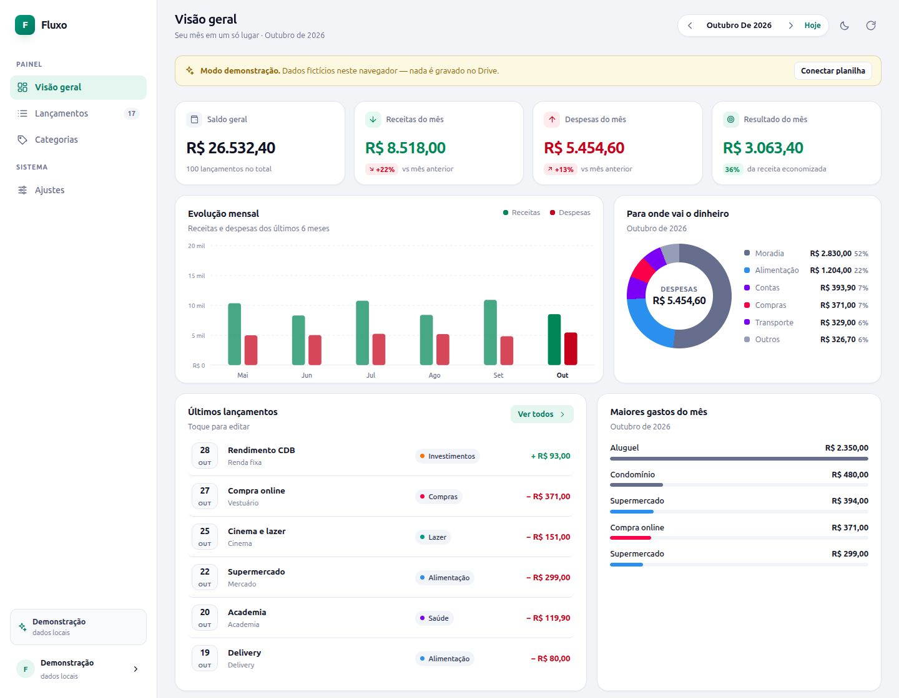

# Fluxo — controle financeiro na sua planilha

Aplicativo web de finanças pessoais que usa **uma planilha do Google Drive como banco de dados**. Sem servidor, sem banco de dados próprio: o navegador lê e grava direto na sua planilha pela API do Google Sheets.



## O que ele faz

- **Lançamentos completos** — data, descrição, categoria, subcategoria, tipo, valor e observação, exatamente nas colunas da sua planilha.
- **Painel do mês** — saldo geral, receitas, despesas, resultado e taxa de economia, com comparação ao mês anterior.
- **Gráficos automáticos** — evolução dos últimos 6 meses e distribuição das despesas por categoria.
- **Filtros e busca** — por mês, tipo, categoria e texto livre.
- **Categorias derivadas dos dados** — agrupadas por categoria e subcategoria, com totais e participação.
- **Edição e exclusão** — com verificação de que a linha certa será alterada na planilha.
- **Tema claro/escuro**, layout responsivo e modo demonstração (`?demo=1`).
- **Exportação CSV** no mesmo formato da planilha.

## Como funciona

```
Navegador  ──(OAuth, token em memória)──►  Google Sheets API  ──►  sua planilha no Drive
```

Não existe backend nem credencial secreta no repositório. O app é 100% estático (HTML/CSS/JS), publicado no GitHub Pages, e o acesso é autorizado por você a cada sessão.

## 1. Configurar o Google (uma vez)

1. Abra o [Google Cloud Console](https://console.cloud.google.com/projectcreate) e crie um projeto.
2. Em **APIs e serviços → Biblioteca**, ative a **Google Sheets API**.
3. Em **APIs e serviços → Tela de consentimento OAuth**:
   - Tipo de usuário: **Externo**.
   - Preencha nome do app, e-mail de suporte e e-mail do desenvolvedor.
   - Em **Usuários de teste**, adicione a sua conta Google.
4. Em **APIs e serviços → Credenciais → Criar credenciais → ID do cliente OAuth**:
   - Tipo: **Aplicativo da Web**.
   - Em **Origens JavaScript autorizadas**, adicione **exatamente** estas duas (sem barra no final):
     ```
     https://SEU-USUARIO.github.io
     http://localhost:5173
     ```
5. Copie o **Client ID** gerado.

> Não é necessário Client Secret. O fluxo usado é o de token do Google Identity Services, próprio para apps estáticos.

## 2. Rodar localmente

```bash
npm run dev
# ou: python3 -m http.server 5173
```

Abra `http://localhost:5173`, cole o **Client ID** na tela inicial e clique em **Entrar com Google**.

Na primeira conexão você pode:

- **Conectar uma planilha existente** colando o link; ou
- **Criar uma planilha nova**, já com a aba `Lançamentos` e os cabeçalhos certos.

## 3. Publicar no GitHub Pages

1. Crie um repositório e envie este projeto para a branch `main`.
2. Em **Settings → Pages**, escolha **Source: Deploy from a branch**, branch `main`, pasta `/ (root)`.
3. Cada push na `main` publica automaticamente (o arquivo `.nojekyll` evita o processamento do Jekyll).
4. Acesse `https://SEU-USUARIO.github.io/NOME-DO-REPO/` e adicione essa origem no Google Cloud (passo 1.4).

O endereço exato da origem aparece na própria tela inicial, com botão de copiar.

## Formato da planilha

Basta uma aba com os cabeçalhos abaixo — **a ordem das colunas pode variar** e o app detecta o cabeçalho mesmo que existam linhas de título acima.

| Data | Descrição | Categoria | Subcategoria | Tipo | Valor | Observação |
|------|-----------|-----------|--------------|------|-------|------------|
| 05/10/2026 | Supermercado | Alimentação | Mercado | Despesa | 289,90 | compra do mês |
| 05/10/2026 | Salário | Salário | CLT | Receita | 8200,00 | |

O que o app aceita na leitura:

- **Data**: data nativa do Sheets, `dd/mm/aaaa` ou `aaaa-mm-dd`.
- **Valor**: número, texto com `R$`, vírgula decimal ou negativo.
- **Tipo**: `Receita`/`Despesa`, `Entrada`/`Saída`, `Provento`/`Gasto`, `Crédito`/`Débito` (sem diferenciar maiúsculas ou acentos).
- **Colunas ausentes**: se `Tipo` não existir, o app infere pelo sinal do valor e pela categoria.
- **Convenção de sinal**: se a planilha usa despesas negativas, o app mantém essa convenção ao gravar.
- **Rótulos de tipo**: o app reutiliza os rótulos que já existem na sua planilha (`gasto`, `provento`, `Saída`, `Despesa`, …).

Os nomes das colunas também podem ser variações como `Histórico`, `Grupo`, `Sub-categoria`, `Natureza`, `Montante`, `Obs`.

### Vocabulário do campo Tipo

Em **Ajustes → Planilha** você escolhe o que o app grava em novas linhas:

| Opção | Despesa | Receita |
|-------|---------|---------|
| Automático (padrão) | reaproveita o rótulo mais usado na planilha | idem |
| Receita/Despesa | `Despesa` | `Receita` |
| Provento/Gasto | `Gasto` | `Provento` |

O modo **Automático** funciona bem para planilhas que já têm dados. Para planilhas novas ou vazias, escolha explicitamente o par que você usa.

### Compatível com Apps Script

Se você tem um script na planilha (por exemplo, uma API própria), o app não interfere nele:

- não cria colunas novas — grava apenas nas sete existentes;
- grava `valor` sempre positivo (o sinal negativo só é usado se a sua planilha já trabalhar assim);
- grava a data como `aaaa-mm-dd` (o Sheets converte para data nativa, e o `Utilities.formatDate` do Apps Script lê normalmente);
- grava o tipo com o vocabulário que você escolher — `gasto`/`provento` inclusive.

O app fala direto com a API do Google Sheets; o seu Apps Script continua sendo uma via independente de acesso aos mesmos dados.

### Várias abas

Se o arquivo tiver mais de uma aba com esses cabeçalhos, o app prioriza a de nome ligado a lançamentos/movimentações/extrato e mantém a escolhida nas próximas sincronizações. Para trocar de aba, desconecte e conecte novamente após ajustar os cabeçalhos.

## Privacidade e segurança

- O token de acesso fica **apenas na memória** do navegador e expira em cerca de 1 hora.
- O escopo solicitado é `https://www.googleapis.com/auth/spreadsheets` — leitura e gravação de planilhas. O app não lista nem acessa outros arquivos do Drive.
- O Client ID é público por natureza e fica salvo no `localStorage` do seu navegador.
- Nenhum dado financeiro passa por servidor intermediário.
- O modo demonstração usa apenas `localStorage` e nunca toca no Drive.

## Solução de problemas

| Mensagem | Causa provável | O que fazer |
|----------|----------------|-------------|
| `redirect_uri_mismatch` / `origin_mismatch` | Origem não autorizada no Google Cloud | Adicione a origem exata (esquema + domínio, sem caminho) em **Origens JavaScript autorizadas** |
| `O navegador bloqueou a janela de login` | Pop-up bloqueado | Permita pop-ups para o site e tente novamente |
| `Sua conta não tem permissão nesta planilha` | Planilha de outra conta | Compartilhe a planilha com o e-mail usado no login ou entre com a conta correta |
| `Não encontrei as colunas "Data" e "Valor"` | Cabeçalho ausente ou abaixo da linha 20 | Confira a primeira linha da aba e os nomes das colunas |
| `Sessão expirada` | Token venceu | Entre novamente com o Google |
| `A planilha mudou desde a última atualização` | Linhas reordenadas/alteradas em paralelo | Atualize e refaça a edição |
| `Muitas requisições` | Limite da API | Aguarde alguns segundos |

> Em apps OAuth em modo **Testing**, o Google mostra um aviso de "app não verificado". Use **Avançado → Acessar** com a conta adicionada em **Usuários de teste**.

## Estrutura do projeto

```
index.html                  tela única do app
assets/styles.css           design system (temas claro/escuro, responsivo)
src/app.js                  estado, rotas, ações e modais
src/auth.js                 Google Identity Services (token OAuth)
src/sheets.js               cliente da API do Google Sheets
src/store.js                leitura/escrita, detecção de colunas, CRUD, demo
src/stats.js                cálculos do painel
src/charts.js               gráficos em SVG/CSS puro
src/utils.js                datas, moeda, parsing e helpers
src/views/                  telas: boas-vindas, painel, lançamentos, categorias, ajustes
scripts/test-sheet.mjs      testes offline da camada de planilha (mock da API)
```

## Testes

```bash
npm test
```

O teste simula a API do Google e cobre: detecção de aba/cabeçalho fora da linha 1, datas seriais e `dd/mm/aaaa`, valores em texto, inferência de tipo, convenção de despesas negativas, além de criação, edição e exclusão de linhas.

## Tecnologia

HTML, CSS e JavaScript puro (ES Modules), sem build e sem dependências de runtime. Os gráficos são SVG e `conic-gradient`; o login usa o Google Identity Services.

---

Feito para manter as finanças em um lugar que você já controla: a sua planilha.
